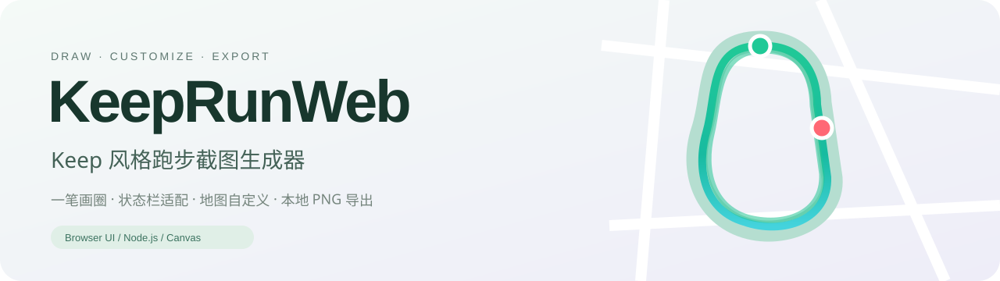
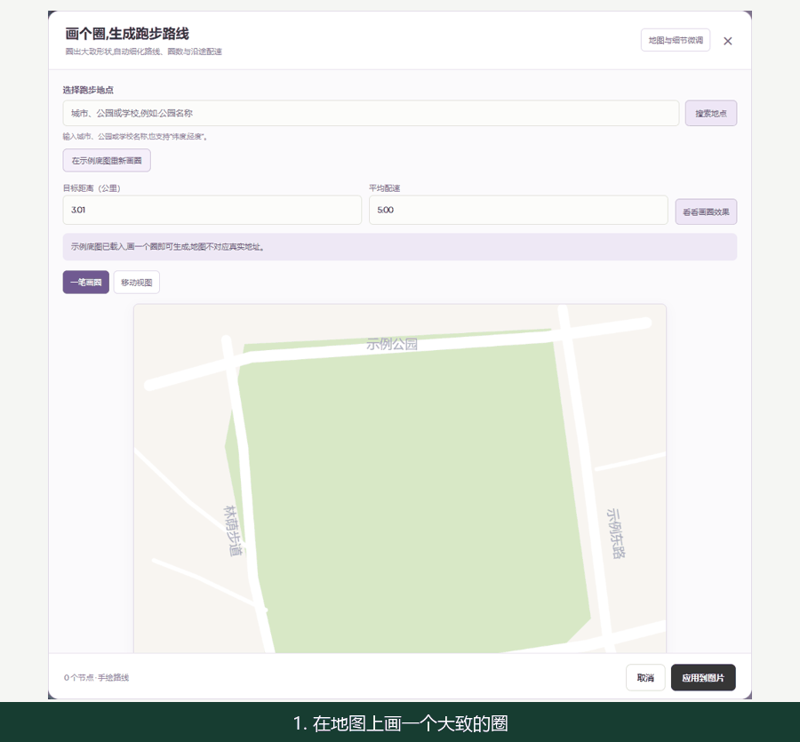
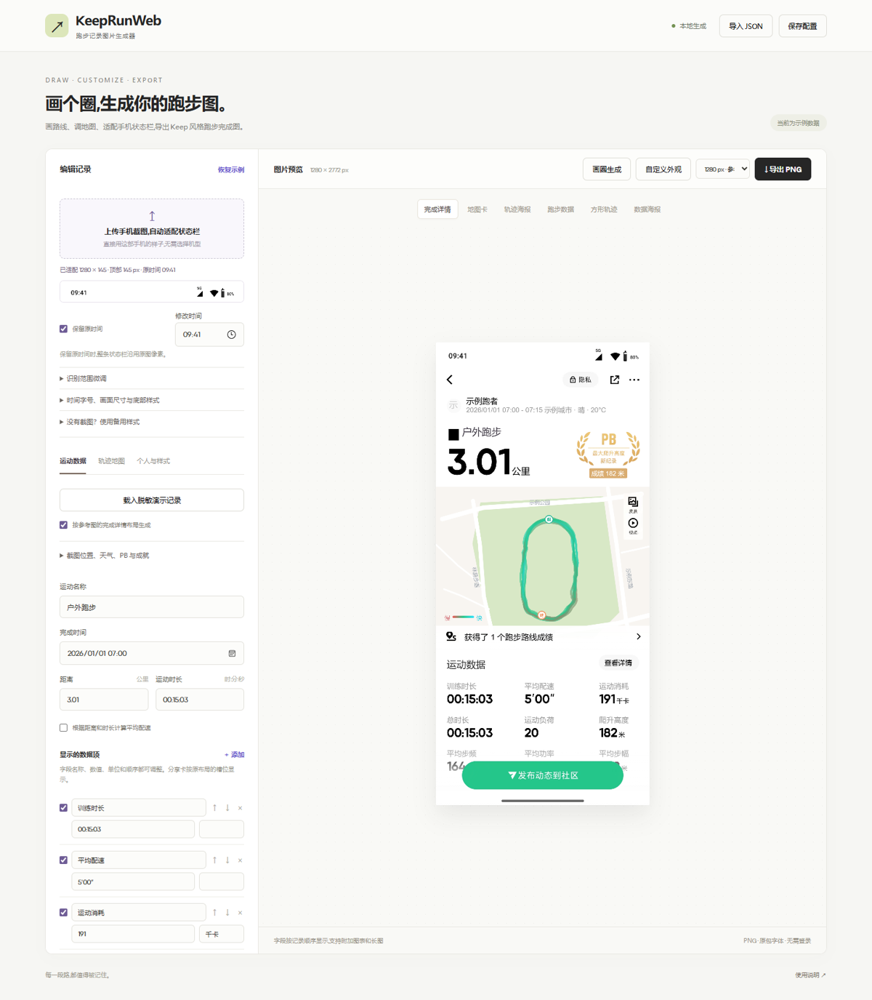
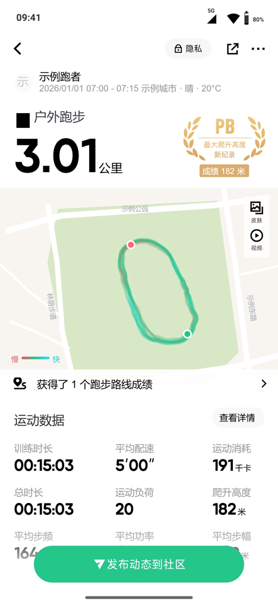

<div align="center">



**画一个圈，生成自然多圈路线；上传一张截图，沿用手机状态栏。**

Keep-style running screenshot generator · Route editor · Phone status bar adaptation

[](https://github.com/2578004027-lgtm/KeepRunWeb/releases/latest)
[](#快速开始)
[](#快速开始)
[](https://github.com/2578004027-lgtm/KeepRunWeb/stargazers)

[下载使用](https://github.com/2578004027-lgtm/KeepRunWeb/releases/latest) · [效果演示](#效果演示) · [功能介绍](#功能介绍) · [反馈问题](https://github.com/2578004027-lgtm/KeepRunWeb/issues) · [English](#english)

</div>

## 这是什么？

**KeepRunWeb 是一个在浏览器里运行的 Keep 风格跑步截图生成器。** 支持手绘路线、地图编辑、手机状态栏适配和运动数据自定义，把预览中的效果直接导出为 PNG。

一笔画出大致形状，自动细化为有局部偏移、透明叠加和配速变化的多圈路线；手机型号不同，可以直接上传自己的截图提取状态栏，再调整时间和画面尺寸。

## 效果演示

### 一笔画圈 → 自动细化 → 调整路线深浅



<details>
<summary><b>展开查看编辑器和导出的完成图</b></summary>



<p align="center"></p>

</details>

演示中的姓名、城市、路名和轨迹均为虚构数据。

## 功能介绍

| 功能 | 可以做什么 |
| --- | --- |
| 🏃 一笔画圈 | 设置距离和配速，细化圈线、圈数、局部偏移及沿途颜色；距离与用时联动 |
| ✏️ 路线编辑 | 画线、拖动节点、插点、删点、分段涂配速、撤销与重做 |
| 🎨 路线外观 | 颜色、深浅、透明度、粗细、描边、起终点和公里标记 |
| 🗺️ 地图自定义 | Keep 风格矢量地图、高德、OSM、上传底图；可编辑地图支持字号、道路、绿地、背景与箭头调整 |
| 📱 状态栏适配 | 从截图提取时间、信号、电量及截图中已有的灵动岛；支持修改时间与裁切范围 |
| 🖼️ 手机画面 | 自定义像素尺寸、时间字号、底部留白和手势条；提供安卓、刘海屏、灵动岛备用样式 |
| 📊 运动数据 | 自定义距离、用时、配速和数据项；调整名称、单位、排列与可见性 |
| 📍 地点与文件 | 搜索地点或输入坐标；导入 GPX、CSV、GeoJSON |
| 💾 保存与导出 | 六种版式、PNG 图片、完整配置 JSON 保存与恢复 |

**默认画圈无需联网路网。** 主动选择“沿道路贴合”时才请求道路数据；在线地图和地点搜索需要网络。

## 快速开始

需要安装 [Node.js 20+](https://nodejs.org/)。应用运行本身没有第三方 npm 依赖。

### 方式一：下载即用

1. 前往 [Releases](https://github.com/2578004027-lgtm/KeepRunWeb/releases/latest)，下载 `KeepRunWeb-v1.0.1.zip` 并解压。
2. Windows：进入 `web` 文件夹，双击 `start.cmd`。
3. macOS / Linux：进入 `web` 文件夹，执行 `node server.mjs`。
4. 浏览器打开 **<http://127.0.0.1:8766/>**。

### 方式二：从源码运行

```bash
git clone https://github.com/2578004027-lgtm/KeepRunWeb.git
cd KeepRunWeb
node server.mjs
```

服务默认只监听本机地址。此仓库提供可本地运行的源码和发布包；完整地图、地点搜索依赖 Node.js 接口，不能只上传到 GitHub Pages 运行。

## 使用方法

1. **选数据**：修改距离、时长和指标，或载入内置演示记录。
2. **画路线**：点击“画圈生成”，选地点或底图，按住画一个大致闭合圈，松手生成。
3. **调外观**：点击“自定义外观”，调整路线深浅、粗细、配速颜色；选择可编辑地图后还能独立修改地图文字和配色。
4. **适配手机**：上传截图提取状态栏。需要换时间时取消“保留原时间”，再调整字号、画面宽高和底部样式。
5. **保存结果**：点击“导出 PNG”；“保存配置”可把图片、数据和路线一起保存为 JSON，下次继续编辑。

## 常见问题

**能导出 FIT 文件吗？** 目前导出 PNG 和编辑配置 JSON，支持导入 GPX / CSV / GeoJSON，没有 FIT 导出功能。

**能适配所有手机吗？** 优先使用上传截图中的状态栏像素，另有备用样式。特殊字体或复杂背景可能需要微调；网页不保证每部手机逐像素一致。

**为什么图片地图的文字不能单独改？** 图片中的文字已经合成。切换到“Keep 风格 · 可编辑地图”，即可分别调整字号、颜色、道路和箭头。

**截图会上传吗？** 截图在浏览器本地分析，项目没有截图上传接口。配置 JSON 会包含所选图片和记录；地图与地点搜索会向相应服务发送视野或查询内容。

## 开发与反馈

```bash
npm ci
npm run check
npm test
npx playwright install chromium
npm run test:browser
```

浏览器检查会自动启动临时本地服务，检查演示数据、画圈、尺寸设置、PNG 和 JSON 导出。Windows 可设置 `BROWSER_CHANNEL=msedge` 使用已安装的 Edge。

欢迎提交 [Issue](https://github.com/2578004027-lgtm/KeepRunWeb/issues) 或 PR。参与方式见 [CONTRIBUTING.md](CONTRIBUTING.md)。如果这个工具对你有用，欢迎点一个 **Star ⭐**，方便以后找到它。

## 相关项目与素材来源

- [KeepTrack](https://github.com/IAMAI-Dev/KeepTrack)：生成操场跑步 FIT 轨迹的 Windows 工具。本项目参考了它清晰的功能介绍与使用文档结构；当前实现面向网页图片编辑，没有复制其 FIT 生成实现。
- 本项目为独立工具，非 Keep 官方应用。Keep 名称、图标和部分参考素材归原权利人；第三方字体与图标的来源及已有许可见 [third-party/README.md](third-party/README.md)。
- 原创代码部分暂未授予额外的开源许可证。公开源码与第三方素材的许可范围分别说明，不将第三方素材视为本项目原创。

## English

**KeepRunWeb** is a browser-based, Keep-style running screenshot editor. Draw a rough loop, generate varied laps, customize the map and pace colors, adapt a phone status bar from a screenshot, and export a PNG.

- Local Node.js server; no runtime npm dependencies.
- Freehand route editing, GPX / CSV / GeoJSON import, configurable maps and phone dimensions.
- PNG export and full JSON configuration roundtrip. FIT export is not implemented.
- Demo identities and locations are fictional. Status-bar images are processed in the browser.

Install Node.js 20+, clone this repository, run `node server.mjs`, and open `http://127.0.0.1:8766/`.
